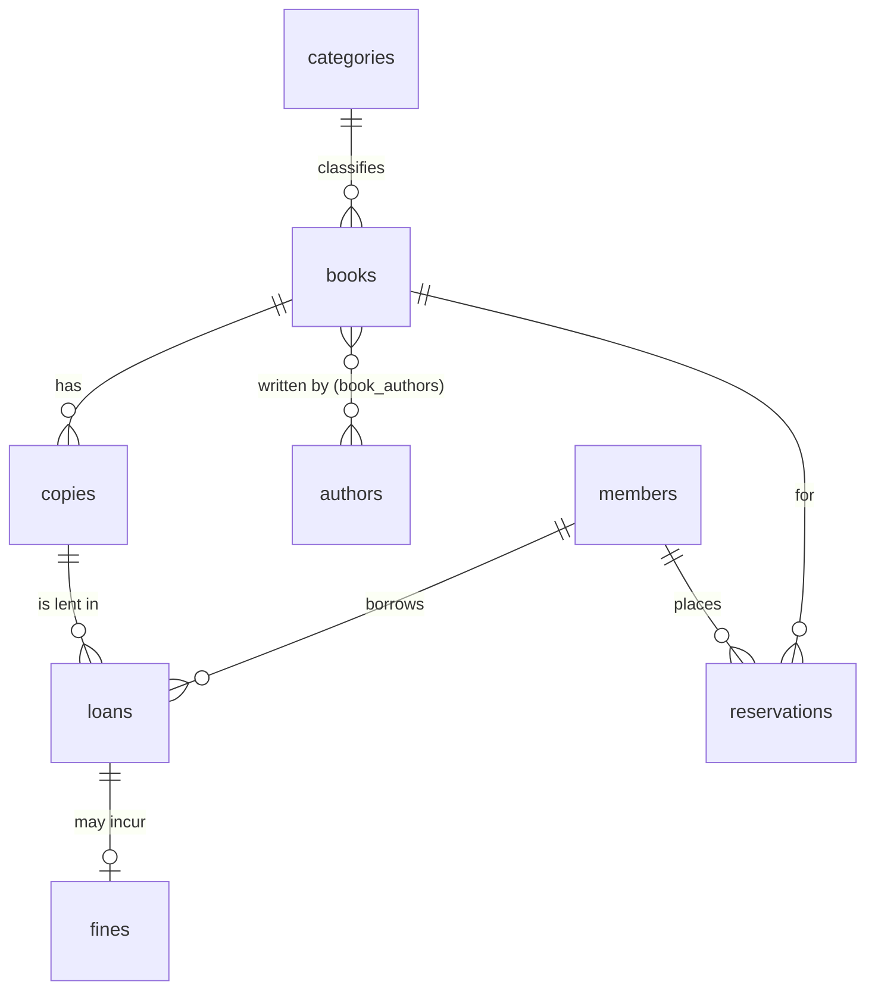

# Schema design interview problems

"Design the database for X" is a standard interview round. You're judged on the **process** as much as the final tables.

## A repeatable method

1. **Clarify requirements.** Who uses it? What must it answer? Which rules are strict? Rough data volume?
2. **List the entities** (nouns) and their **attributes**.
3. **Find the relationships** and their cardinality: 1:1, 1:N (FK on the "many" side), M:N (junction table).
4. **Choose keys:** surrogate PK on every table, `UNIQUE` on natural keys.
5. **Add constraints** that encode the business rules: `NOT NULL`, `CHECK`, `UNIQUE`, FKs with the right `ON DELETE`.
6. **Check normalization** (3NF), then denormalise deliberately if a hot read needs it.
7. **Write the key queries** against your schema. This proves it works and finds missing columns.
8. **Index** for those queries; talk about growth, history/auditing, soft deletes and concurrency.

---

## Worked example: a library system

### 1. Requirements (after clarifying)

- The library has **books** (titles) and several physical **copies** of each.
- A book can have several **authors**; an author writes many books. Books belong to **categories**.
- **Members** borrow copies. A loan is due 14 days later. A member may have at most **5** active loans.
- A copy can be on loan to **only one** member at a time.
- Overdue returns incur a **fine** (10 per day).
- Members can **reserve** a title when no copy is free; first come, first served.
- Questions to answer: what's available? who has what overdue? most borrowed books? a member's history?

### 2–3. Entities and relationships



| Relationship | Cardinality | Modelled as |
|---|---|---|
| book → copies | 1:N | `copies.book_id` FK |
| book ↔ authors | M:N | junction table `book_authors (book_id, author_id)` |
| category → books | 1:N | `books.category_id` FK |
| member → loans, copy → loans | 1:N each | `loans.member_id`, `loans.copy_id` |
| loan → fine | 1:0..1 | `fines.loan_id` UNIQUE FK |
| member/book → reservations | 1:N each | `reservations.member_id`, `reservations.book_id` |

Design decisions worth saying out loud:

- **Book vs copy** are separate entities: title-level data (ISBN, authors) isn't repeated per copy, and loans point at the exact physical item.
- **A loan is a fact with history**, not a column on `copies`. `copies.status` alone would lose who borrowed what and when.
- **"Only one active loan per copy"** is enforced by the database: a partial unique index on `loans (copy_id) WHERE returned_at IS NULL`.
- **"At most 5 active loans per member"** can't be a simple constraint. Enforce it in a trigger or the borrowing procedure, and lock the member row so two concurrent borrows can't both pass the check.
- **Fines** are stored (not only computed) because they can be paid, waived and audited.

### 4–6. Schema

See [schema-design.sql](schema-design.sql) for the full DDL with constraints, sample data, the borrow procedure and the queries. Key parts:

```sql
CREATE TABLE loans (
    loan_id      INT GENERATED ALWAYS AS IDENTITY PRIMARY KEY,
    copy_id      INT  NOT NULL REFERENCES lib.copies (copy_id),
    member_id    INT  NOT NULL REFERENCES lib.members (member_id),
    borrowed_at  DATE NOT NULL DEFAULT CURRENT_DATE,
    due_at       DATE NOT NULL,
    returned_at  DATE,
    CHECK (due_at > borrowed_at),
    CHECK (returned_at IS NULL OR returned_at >= borrowed_at)
);
-- a copy can't be lent twice at the same time
CREATE UNIQUE INDEX one_active_loan_per_copy ON lib.loans (copy_id) WHERE returned_at IS NULL;
```

### 7. Queries the schema must answer

All in [schema-design.sql](schema-design.sql): available copies per title, overdue loans with the fine so far, a member's history, the 3 most borrowed titles, the next member in the reservation queue.

### 8. Indexing and follow-ups

- Index every FK (`copies.book_id`, `loans.member_id`, `loans.copy_id`, `book_authors.author_id`...).
- Partial index `loans (due_at) WHERE returned_at IS NULL` for the daily overdue job.
- Full-text / trigram index on `books.title` for search.
- Follow-ups an interviewer may ask: multiple branches (add `branches`, `copies.branch_id`), e-books (copies without a physical item, concurrent-licence limits), member suspension (`members.status`), keeping loans when a member leaves (soft delete, never `CASCADE`).

---

## Practice problems (model answers in brief)

### Ride-sharing app (Uber-like)

- **Entities:** `riders`, `drivers`, `vehicles` (driver 1:N vehicles), `trips`, `trip_status_history`, `payments`, `ratings`, `driver_locations`.
- **Key points:** `trips` references rider, driver, vehicle; pickup/drop-off coordinates; requested/accepted/started/ended timestamps; fare. Status as a `CHECK`-constrained column **plus** a history table for auditing. Two ratings per trip (rider→driver and driver→rider): `ratings (trip_id, rater_type)` unique. `driver_locations` is very high-volume and short-lived: often kept outside the RDBMS (Redis/geo index) with only trip-level data stored.
- **Queries:** a driver's earnings this week; average rating per driver; trips per city per hour.

### Hotel booking

- **Entities:** `hotels`, `room_types`, `rooms`, `guests`, `bookings`, `booking_rooms`, `payments`, `rates` (price per room type per date range).
- **Key point:** **no double booking**. PostgreSQL: `EXCLUDE USING gist (room_id WITH =, stay WITH &&)` on a `daterange` column. Elsewhere: an inventory table with one row per room per night and a unique key, or `SELECT ... FOR UPDATE` in the booking transaction.
- **Queries:** free rooms of a type for given dates; occupancy % per night; revenue per hotel per month.

### Social media (Twitter/Instagram-like)

- **Entities:** `users`, `posts`, `follows (follower_id, followee_id)` (self M:N), `likes (user_id, post_id)`, `comments` (self-referencing `parent_comment_id` for threads), `hashtags`, `post_hashtags`.
- **Key points:** composite PKs on `follows` and `likes` prevent duplicates; `CHECK (follower_id <> followee_id)`. Counts (`like_count`) are often denormalised onto `posts` for fast reads and updated by triggers or async jobs. The home feed at scale is precomputed (fan-out on write) rather than a big join.
- **Queries:** a user's feed (posts by people they follow, newest first, keyset-paginated); mutual followers; trending hashtags in the last 24 hours.

### E-commerce

The tutorial's own [sample database](../sample-db/README.md) is a worked answer. Discuss what you'd add: `addresses`, `payments`, `shipments`, `inventory` per warehouse, `carts`, product variants (size/colour), price history.
