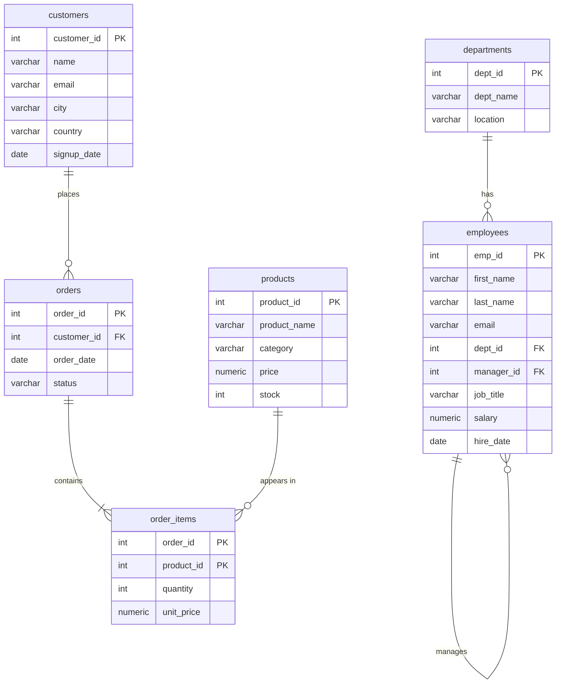

# Sample database

Every lesson runs against this one small database, so you only have to learn one schema.

```bash
createdb sqltutorial                         # once
psql -d sqltutorial -f sample-db/schema.sql  # drops and recreates all tables
psql -d sqltutorial -f sample-db/seed.sql    # loads the data
```

Re-run both files whenever a lesson has changed the data and you want a clean start.

## Tables



`accounts (account_id, owner_name, balance)` is a stand-alone table used by the transactions lesson.

| Table | Rows | Notes |
|---|---|---|
| departments | 6 | **Research** has no employees |
| employees | 16 | Hierarchy via `manager_id`. **Tom Wilson** has no department and no email. Salaries 95000 and 70000 appear twice (useful for RANK vs DENSE_RANK). |
| customers | 10 | **Omar Hassan** and **Sara Lee** never ordered. **Emma Brown** has no email. |
| products | 10 | **Desk Lamp** was never ordered and has 0 stock |
| orders | 18 | Statuses: pending, shipped, delivered, cancelled. Dates span 2025‑01 to 2026‑03. |
| order_items | 25 | `unit_price` is what was charged; it sometimes differs from `products.price` |
| accounts | 3 | Alice 5000, Bob 2000, Carol 0 |

## Other databases

The SQL is written for PostgreSQL but is close to standard:

| Database | What to change |
|---|---|
| MySQL 8 | Skip line 1 (the PostgreSQL `SET`): `sed '1d' sample-db/schema.sql \| mysql ...`. MySQL accepts and ignores `CASCADE`. See [00-setup/mysql.md](../00-setup/mysql.md). |
| SQLite | Drop the `SET` and `DROP TABLE` lines; the tables themselves load as-is (types aren't enforced). See [00-setup/sqlite.md](../00-setup/sqlite.md). |
| Oracle | `VARCHAR` → `VARCHAR2`, `NUMERIC` → `NUMBER`, `INT` → `NUMBER(10)`, dates as `DATE '2025-01-10'`, and `DROP TABLE x CASCADE CONSTRAINTS` (no `IF EXISTS` before 23c). |
